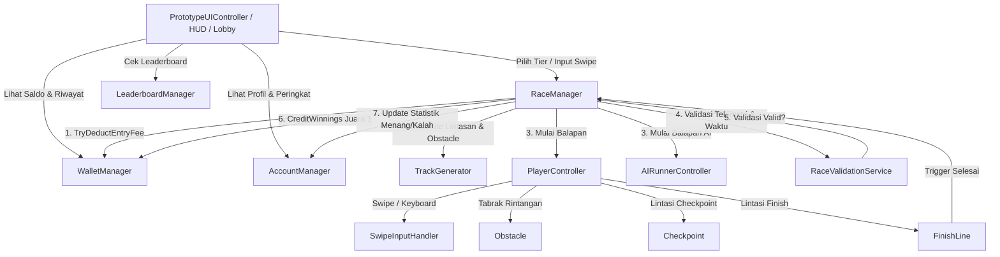

# 🎮 Prototipe Game Balap Lari 3D (Racing-Runner) dengan Sistem Entry Koin Virtual

Dokumen ini memuat panduan lengkap arsitektur sistem, struktur project Unity3D, dan tata cara menjalankan prototipe game balap lari 3D berbasis koin virtual (*skill-based racing runner*).

---

## 📑 Daftar Isi
1. [Arsitektur & Prinsip Desain Modular](#1-arsitektur--prinsip-desain-modular)
2. [Struktur Folder Project Unity](#2-struktur-folder-project-unity)
3. [Daftar Modul & Script Utama](#3-daftar-modul--script-utama)
4. [Mekanika Ekonomi & Payout Multiplier](#4-mekanika-ekonomi--payout-multiplier)
5. [Integritas Balapan & Anti-Cheat Logic](#5-integritas-balapan--anti-cheat-logic)
6. [Panduan Menjalankan Prototipe di Unity Editor](#6-panduan-menjalankan-prototipe-di-unity-editor)
7. [Kontrol Permainan (Mobile Touch vs PC/Editor)](#7-kontrol-permainan-mobile-touch-vs-pceditor)
8. [Catatan Hukum & Kepatuhan Legalitas](#8-catatan-hukum--kepatuhan-legalitas)

---

## 1. Arsitektur & Prinsip Desain Modular

Sistem dibangun dengan memisahkan **Logika Ekonomi**, **Logika Gameplay/Fisika**, **Layanan Validasi Otoritatif (Server Mock)**, dan **UI Presentation**:



### Keuntungan Arsitektur Ini:
1. **Decoupled (Terpisah)**: `WalletManager` sama sekali tidak bergantung pada fisika Unity. Jika kelak game dihubungkan ke backend database nyata (misal Node.js/Go/Firebase), modul `WalletManager` dan `RaceValidationService` dapat dipindahkan ke sisi server tanpa mengubah logika pergerakan `PlayerController`.
2. **Zero-Setup Bootstrap**: Dilengkapi dengan `GameInitializer.cs` yang mampu mendeteksi ketiadaan objek di scene kosong dan secara prosedural men-generate lintasan 3D, pemain, rintangan, bot AI lawan, pencahayaan, serta UI secara instan.

---

## 2. Struktur Folder Project Unity

```text
d:/KERJAAN/GAME3DBalap/
│
├── PRD - Game Balap Lari 3D dengan Sistem Coin.md
├── PANDUAN_SETUP_PROTOTIPE_UNITY.md
│
└── Assets/
    └── Scripts/
        ├── Core/
        │   ├── GameConstants.cs          # Konstanta fisika, geometri jalur, tier multiplier
        │   ├── GameEnums.cs              # Enum state balapan, jalur, tipe rintangan, tier
        │   ├── GameInitializer.cs        # Bootstrap scene otomatis (Plug & Play)
        │   └── UnityHelper.cs            # Kompatibilitas multi-versi Unity (2020 s.d Unity 6)
        │
        ├── Economy/
        │   ├── TransactionData.cs        # Entitas data riwayat transaksi koin virtual
        │   └── WalletManager.cs          # Saldo koin, potong entry fee, kredit hadiah, faucet
        │
        ├── Auth/
        │   ├── UserProfile.cs            # Data akun, level, total balapan, rasio menang
        │   └── AccountManager.cs         # Pengelola profil & penyimpanan lokal (PlayerPrefs)
        │
        ├── Gameplay/
        │   ├── Player/
        │   │   ├── PlayerController.cs       # Kontrol gerak 3 jalur, lari, lompat, slide, collision
        │   │   ├── BlockyCharacterAnimator.cs # Karakter balok Roblox/Minecraft & animasi procedural
        │   │   ├── SwipeInputHandler.cs      # Deteksi gesture swipe mobile & keyboard fallback
        │   │   └── SmoothCameraFollow.cs     # Kamera smooth runner pihak ketiga (third-person)
        │   │
        │   ├── AI/
        │   │   └── AIRunnerController.cs     # AI bot lawan cerdas (deteksi obstacle & ganti jalur)
        │   │
        │   └── Race/
        │       ├── RaceManager.cs        # Pengatur siklus balapan, matchmaking, ranking, finish
        │       ├── TrackGenerator.cs     # Generator lintasan 3D (aspal, garis neon, tiang finish)
        │       ├── TrackSegment.cs       # Segmen modular lintasan dengan spawner rintangan
        │       ├── Obstacle.cs           # Komponen rintangan (Barrier, Hurdle, HighBeam)
        │       ├── Checkpoint.cs         # Sensor pencatat telemetri kecepatan & waktu checkpoint
        │       └── FinishLine.cs         # Sensor garis akhir penentu juara
        │
        ├── NetworkValidation/
        │   └── RaceValidationService.cs # Validasi otoritatif (Anti-Speedhack & Anti-Teleport)
        │
        ├── Social/
        │   └── LeaderboardManager.cs     # Mock leaderboard peringkat pemain & koin
        │
        └── UI/
            └── PrototypeUIController.cs  # Tampilan antarmuka runtime lengkap (Lobby, HUD, Result, Riwayat Koin, Leaderboard)
```

---

## 3. Daftar Modul & Script Utama

| Nama Script | Kategori | Fungsi Utama |
|---|---|---|
| [`GameInitializer.cs`](file:///d:/KERJAAN/GAME3DBalap/Assets/Scripts/Core/GameInitializer.cs) | Core | Mempersiapkan scene kosong secara otomatis saat Play ditekan |
| [`WalletManager.cs`](file:///d:/KERJAAN/GAME3DBalap/Assets/Scripts/Economy/WalletManager.cs) | Economy | Mengelola saldo koin virtual, transaksi entry fee, payout, dan riwayat |
| [`PlayerController.cs`](file:///d:/KERJAAN/GAME3DBalap/Assets/Scripts/Gameplay/Player/PlayerController.cs) | Gameplay | Penggerak karakter pelari (ganti 3 jalur, melompat, berseluncur, stumbler) |
| [`AIRunnerController.cs`](file:///d:/KERJAAN/GAME3DBalap/Assets/Scripts/Gameplay/AI/AIRunnerController.cs) | AI | Lawan bot adaptif yang mampu mendeteksi rintangan via Raycast |
| [`TrackGenerator.cs`](file:///d:/KERJAAN/GAME3DBalap/Assets/Scripts/Gameplay/Race/TrackGenerator.cs) | Race | Membangun lintasan balap 3D modular secara dinamis beserta rintangan |
| [`RaceValidationService.cs`](file:///d:/KERJAAN/GAME3DBalap/Assets/Scripts/NetworkValidation/RaceValidationService.cs) | Anti-Cheat | Memvalidasi integritas catatan waktu fisik & checkpoint sebelum payout |
| [`PrototypeUIController.cs`](file:///d:/KERJAAN/GAME3DBalap/Assets/Scripts/UI/PrototypeUIController.cs) | UI | Render UI modern gelap (Lobby, HUD balapan, hasil payout, leaderboard, riwayat) |

---

## 4. Mekanika Ekonomi & Payout Multiplier

Dalam prototipe ini, sistem koin menggunakan **koin virtual simulasi** (tidak terhubung dengan uang riil):

| Tier Balapan | Biaya Entry | Pengganda (Multiplier) | Hadiah Juara 1 (Payout) | Keuntungan Bersih Juara 1 | Hasil Jika Kalah (Juara 2+) |
|:---:|:---:|:---:|:---:|:---:|:---:|
| **Bronze** | 100 Coins | **2.0x** | 200 Coins | +100 Coins | Biaya 100 Coins Hangus |
| **Silver** | 500 Coins | **2.2x** | 1,100 Coins | +600 Coins | Biaya 500 Coins Hangus |
| **Gold** | 1,000 Coins | **2.5x** | 2,500 Coins | +1,500 Coins | Biaya 1,000 Coins Hangus |

- **Saldo Awal**: Setiap instalasi baru mendapatkan saldo pengujian **1,500 Coins**.
- **Faucet Testing**: Terdapat tombol **"+500 Faucet"** di Lobby untuk menambahkan koin virtual tanpa batas guna keperluan playtesting developer.
- **Transparansi Riwayat**: Tombol **"Riwayat Koin"** menampilkan setiap mutasi debit/kredit koin lengkap dengan jam transaksi, jenis aktivitas, perubahan saldo, dan ID balapan.

---

## 5. Integritas Balapan & Anti-Cheat Logic

Sesuai arahan PRD untuk menghindari manipulasi hasil pertandingan oleh client:
1. **Anti-Speedhack**:
   - Sistem menghitung `minPossibleTime = totalJarak / MAX_RUN_SPEED`.
   - Jika pemain menyelesaikan balapan lebih cepat dari batas kecepatan fisik maksimum (dengan toleransi 5%), sistem otomatis membatalkan klaim kemenangan dan menandai hasil sebagai manipulasi.
2. **Anti-Teleport / Shortcut**:
   - Checkpoint diletakkan di sepanjang lintasan.
   - Waktu setiap checkpoint dicatat dalam telemetri. Jika ada checkpoint yang terlewat atau timestamp mundur/tidak berurutan, balapan dianggap tidak valid.
3. **Validation Token**:
   - Setiap balapan yang valid menghasilkan token unik (misal: `VAL-A94F81C2B0`) yang dicatat bersama transaksi di wallet.

---

## 6. Panduan Menjalankan Prototipe di Unity Editor

Anda tidak perlu menyusun puluhan prefab atau mengkonfigurasi Canvas secara manual karena sistem sudah dilengkapi **auto-primitive visual generation**:

### Langkah 1: Buka Project di Unity
1. Buka **Unity Hub**.
2. Klik tombol **Add** -> **Add project from disk**.
3. Pilih folder: `d:\KERJAAN\GAME3DBalap`.
4. Buka project menggunakan Unity versi apapun (direkomendasikan Unity 2021 LTS, 2022 LTS, 2023, atau Unity 6).

### Langkah 2: Buat / Buka Scene Baru
1. Di Unity Editor, klik menu: **File -> New Scene**.
2. Pilih template **Basic (Built-in)** atau scene kosong, lalu klik **Create**.

### Langkah 3: Pasang `GameInitializer`
1. Di panel **Hierarchy**, klik kanan -> **Create Empty**.
2. Beri nama GameObject tersebut: `_GameBootstrap`.
3. Di panel **Inspector**, klik **Add Component**, cari dan tambahkan:
   - `GameInitializer`
4. *(Opsional)* Jika Anda ingin menyusun komponen secara manual tanpa `GameInitializer`, cukup tambahkan:
   - `TrackGenerator`
   - `PlayerController`
   - `AIRunnerController`
   - `RaceManager`
   - `PrototypeUIController`

### Langkah 4: Tekan Tombol Play ▶️
1. Tekan tombol **Play** di bagian atas Unity Editor.
2. `GameInitializer` akan otomatis:
   - Menghasilkan lintasan balap 3D modular dengan marka jalan neon.
   - Menempatkan rintangan (Barrier, Hurdle melompat, HighBeam berseluncur).
   - Memunculkan karakter pemain (kapsul biru) dan bot lawan (kapsul merah).
   - Menyiapkan kamera smooth follow.
   - Menampilkan UI Lobby futuristik dengan saldo 1,500 Coins.
3. Klik tombol **TANDING** pada salah satu tier (misal Bronze 100 Coin).
4. Nikmati sensasi balapan melawan AI bot secara real-time!

---

## 7. Kontrol Permainan (Mobile Touch vs PC/Editor)

Input ditangani secara terpadu oleh [`SwipeInputHandler.cs`](file:///d:/KERJAAN/GAME3DBalap/Assets/Scripts/Gameplay/Player/SwipeInputHandler.cs):

| Aksi Karakter | Kontrol Keyboard (PC / Unity Editor) | Kontrol Layar Sentuh (Mobile Android/iOS) | Respon Terhadap Rintangan |
|:---:|:---:|:---:|:---|
| **Pindah Jalur Kiri** | Tombol **A** atau **Panah Kiri** | **Swipe ke Kiri** | Menghindari rintangan penuh (*BarrierFull*) |
| **Pindah Jalur Kanan** | Tombol **D** atau **Panah Kanan** | **Swipe ke Kanan** | Menghindari rintangan penuh (*BarrierFull*) |
| **Melompat** | Tombol **W**, **Panah Atas**, atau **Spasi** | **Swipe ke Atas** | Melompati rintangan rendah (*HurdleLow*) |
| **Berseluncur (Slide)** | Tombol **S** atau **Panah Bawah** | **Swipe ke Bawah** | Menunduk di bawah balok gantung (*HighBeam*) |

---

## 8. Catatan Hukum & Kepatuhan Legalitas

> [!WARNING]
> **PENTING UNTUK DIPERHATIKAN SEBELUM TAHAP PRODUKSI KOMERSIAL:**
> - Seluruh implementasi pada repositori ini **HANYA menggunakan mata uang koin virtual untuk keperluan riset prototipe dan validasi desain game**.
> - Mekanisme *entry-fee dengan payout pengganda kemenangan*, jika dikaitkan dengan transaksi uang asli (real-money wagering/deposit/cashout), tunduk pada regulasi ketat perundang-undangan (khususnya Pasal 303 KUHP & UU ITE di Indonesia, serta kepatuhan Google Play/Apple App Store *Real-Money Gaming Policy*).
> - Jangan menambahkan integrasi payment gateway uang asli tanpa kajian dan persetujuan dari tim konsultan hukum resmi.
